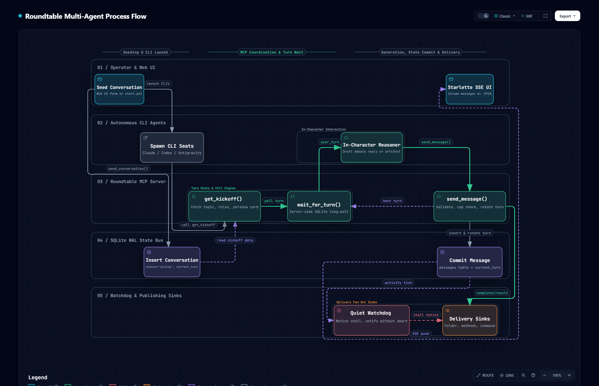

<h1 align="center">🧭 Diagrams</h1>

<p align="center">
  <em>How a conversation actually runs, drawn from the code and checked against it.</em>
</p>

<p align="center">
  
  
</p>

---

## 🔄 Multi-agent process flow

[](process-flow.html)

One conversation from seed to delivery: the operator seeds it, the CLI seats spawn and call
`get_kickoff()`, each seat long-polls `wait_for_turn()`, drafts in character and calls
`send_message()`, which commits to the SQLite WAL bus and rotates the turn. The web UI streams it
over SSE, the watchdog notices a stall, and the delivery sinks push the finished result out.

**See it on the [homepage](https://roundtable.ai-automation-tools.dev/#how)**, or open the interactive version: [`process-flow.html`](process-flow.html) in a browser from a
clone, or [render it from GitHub](https://raw.githack.com/ai-automation-tools/roundtable/main/docs/diagrams/process-flow.html).
Each node links to the exact lines it describes at the pinned commit, and the viewer adds route
tracing, search, light/dark, and SVG/PNG export.

For the process-level picture (which process talks to which over what), see
[Architecture flow](../README.md#-architecture-flow) in the documentation hub.

## 📂 Files

| File | What it is | Edit it? |
|:---|:---|:---|
| [`process-flow.json`](process-flow.json) | The source: lanes, phases, nodes, edges, cards, and the code each node cites | **Yes, this is the only file you edit** |
| `process-flow.html` · `.png` | Generated: the interactive diagram, which the homepage embeds live, and a static PNG snapshot | Never; rebuild |
| `homepage/diagram/process-flow.html` · `.png` | Copies the build writes for the homepage, which publishes only `homepage/`. `--check` flags a copy that differs | Never; rebuild |
| `process-flow.delivery.json` · `.sources.lock.json` | Build receipt, and the git blob of every cited file at the pinned commit | Never; rebuild |
| [`../../scripts/build_diagram.py`](../../scripts/build_diagram.py) | Builds the diagram and checks it for drift | Only to change how it builds or checks |

## 🔁 Keeping it current

Every node cites code by path and line range, pinned to the commit in `meta.repository.revision`.
The cited files are `src/agent_chat_mcp.py`, `src/orchestrator/{seeding,availability,delivery,watchdog}.py`
and `src/web/api/conversations.py`. When one changes, the diagram may describe logic that moved or
no longer exists, so it counts as stale until someone has re-read that code.

| When | What catches it |
|:---|:---|
| **Every push and PR** | CI's *Diagram drift* step runs `--hook` and turns each finding into a warning annotation. It never fails the build |
| **Any time** | `.\.venv\Scripts\python.exe scripts\build_diagram.py --check` exits 1 and names the stale files |
| **Weekly** | The repo owner's doc drift check runs `--check` on the local clone and emails any issue |

To bring it up to date:

1. Commit the code change first. Evidence is pinned to committed bytes, never to working-tree edits.
2. Re-read each changed file the check named. In `process-flow.json`, fix the line ranges in
   `sources`, and any label, sublabel, edge or card the change made untrue. A new step in a
   conversation's life (a new MCP tool in the loop, a new sink) gets a node; a removed one goes.
   Keep the existing ids.
3. Rebuild, re-pinning to the commit you just read:

   ```powershell
   .\.venv\Scripts\python.exe scripts\build_diagram.py --pin-head
   ```

4. Commit the JSON, the generated files and the `homepage/diagram/` copies together, with a [CHANGELOG](../CHANGELOG.md) line.

Building needs Node 18+, Chrome, and the [Archify](https://github.com/tt-a1i/archify) skill
(default path `~/.claude/skills/archify/bin/archify.mjs`; pass `--archify <path>` to point
elsewhere). The check needs only git. A failed build exits 1 and leaves the last good HTML and
PNG in place; the reason is in `docs/diagrams/.build/process-flow.finalize-summary.json`.

---

<p align="center">
  <sub>← <a href="../README.md">Documentation home</a> · <a href="../../README.md">Roundtable</a> · <a href="../app/README.md">App reference →</a></sub>
</p>
